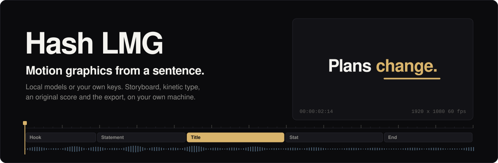
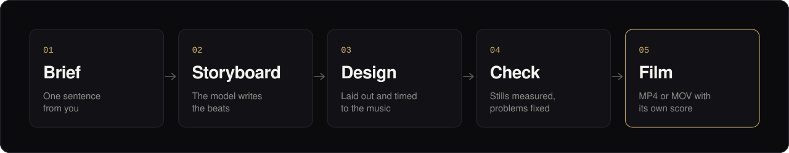
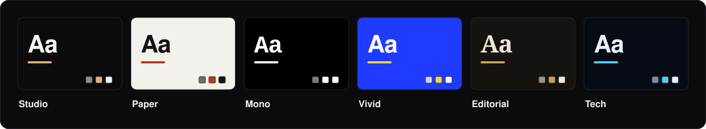

<div align="center">

<picture>
  <source media="(prefers-color-scheme: light)" srcset="docs/assets/hero-light.svg">
  
</picture>

<br><br>

### Hash Local Motion Graphics

**Type what the film should say. Get a designed, timed, scored motion-graphics film back.**<br>
Made by the model on your own computer, or by any cloud model on your own key.

<p>     </p>

</div>

<br>

> **Hash LMG is Hash Local Motion Graphics.** The best AI models already make motion graphics by working like a studio: they plan the story, write the animation, render frames, look at the stills and fix what is wrong. Hash LMG turns that way of working into an app, and does the hard parts itself, so even a small model on a laptop can make a film that looks designed.

<br>

## How a film is made

<picture>
  <source media="(prefers-color-scheme: light)" srcset="docs/assets/pipeline-light.svg">
  
</picture>

| Step | What happens |
|---|---|
| **01 Brief** | You describe the film in a sentence or two: what it is for, how long, landscape or vertical. |
| **02 Storyboard** | The model writes only the words and numbers, beat by beat: a hook, a statement, a stat, a list, a quote, an end card. |
| **03 Design** | The app lays the beats out in a style, times every line to how long it takes to read, and starts every scene on the beat of the music. |
| **04 Check** | Key moments are rendered and measured: text off the frame, outside a phone's safe area, too small, too faint, too fast to read, or a scene that sits still too long. What rules can fix, they fix. The rest goes back to the model. |
| **05 Film** | An original score fitted to the cuts, narration if you want it, mastered to the loudness YouTube and Instagram play at, written to MP4 or MOV. |

<br>

## One app, any model

A three-billion-parameter model cannot lay out a film. It can write a good storyboard. So Hash LMG gives every model the job it can actually do:

| Way of working | For | The model writes | The app does |
|---|---|---|---|
| **Guided** | Small local models, under 10B | The storyboard: words and numbers only | All of the layout, timing, motion and sound |
| **Plan** | Mid-size and large models | A full scene plan, starting from the app's own design | Repairs it, checks it, sends back what is wrong |
| **Code** | The strongest cloud models | Their own animation code, frame by frame | Runs it in a locked box with no network, no storage and no clock, then checks the stills |

The app suggests the way of working from the model's size, and you can always choose another. A model that can see pictures also reviews a contact sheet of stills, like a creative director, and asks for changes once.

<br>

## Six looks, built in

<picture>
  <source media="(prefers-color-scheme: light)" srcset="docs/assets/styles-light.svg">
  
</picture>

Each style is a complete design: palette, type, background, and the two or three transitions it cuts with. **Studio** is near-black and quiet. **Paper** is a Swiss grid with a red mark. **Mono** types on and cuts on the beat. **Vivid** changes colour field scene by scene. **Editorial** sets serif headlines and holds long. **Tech** draws contour lines behind precise type.

<br>

## What a film is made of

| Part | What it does |
|---|---|
| **Kinetic type** | Letters, words, typewriter, mask reveals and wipes, with accent words, underlines drawn on and highlighter sweeps |
| **Motion** | Fourteen entrances, plus exits, holds and keyframes, eased the way motion designers ease: fast in, no bounce |
| **Shapes and data** | Rings, lines, arrows and any SVG path drawn on stroke by stroke; counters that count up; bar and line charts that grow |
| **Camera and cuts** | Slow pushes and pans per scene; push, slide, zoom-through, wipe, fade and dip transitions |
| **Formats** | 16:9, 9:16, 1:1 and 4:5, at 24 to 60 frames a second |
| **Sound** | Three score flavours (deep pulse, soft, cinematic) built from the film's own scenes: a build into the reveal, a boom on the drop, a fade on the end card |
| **Narration** | One line per scene, the music lowered under the voice, captions that light up word by word as they are said |

<br>

## Models and voices

**On your computer:** Ollama, LM Studio and llama.cpp.<br>
**In the cloud, on your own key:** Anthropic, OpenAI, Google Gemini, OpenRouter, Groq, DeepSeek, Mistral, xAI, Moonshot, Together AI, Fireworks AI and Cerebras.<br>
**Voices, planned:** Chatterbox and Kokoro through your own install, on the processor or the graphics chip; any local speech server; or OpenAI's voices.

<br>

## Where it stands

Hash LMG is being built in the open. This is exactly what exists today:

| Works today | Written, not yet run | Next |
|---|---|---|
| Scene format and its repair | Requests to every model service | The desktop app itself (Tauri) |
| The engine: type, shapes, charts, transitions | Motion blur, and MOV export | Voices through Chatterbox and Kokoro |
| Film checks and automatic fixes | Sound through the system's own encoder | The automated check suite |
| The storyboard compiler, in all six styles | Narration mix, word timing and captions | First release for macOS and Windows |
| The director, with a scripted model | Processor or graphics-chip choice for Ollama | |
| Score and mastering | | |
| The editor: preview, timeline, inspector, director, settings | | |
| Rendering in a background worker, and MP4 export | | |

"Works today" means exercised in Node with a stand-in canvas and a scripted model, or, for the editor and MP4 export, in headless Chrome with a scripted model. Nothing has been run as an app yet, and nothing has been released.

<br>

## Built to stay yours

Hash LMG is designed so that:

- **There is no account and no server of ours.** Requests go from your computer to the model you chose, and nowhere else.
- **It works offline.** With a local model, every part of a film is made on your computer.
- **Your films are files.** A project is one JSON file; an export is a normal video.
- **It is readable to the last line.** Plain JavaScript and Rust, no bundler, no minified code.

<br>

## Under the hood

```
src/
  index.html       the editor window
  css/             the editor's colours, type and layout, dark and light
  core/            pure modules, no page access: the checks run them in Node
    scene/         format, normaliser, film checks, storyboard, compiler, examples
    engine/        easing, keyframes, paths, the drawing kit, motion, the renderer
    director/      prompts, the plan-check-revise loop, the code check
    providers/     model services, requests and streams, model sizes, voices
    audio/         synth, score, narration mix, loudness, word timing, WAV
    export/        the MP4 and MOV writer
  render/          the locked-down render worker, its host, video export
  platform/        the desktop app or a browser: projects, files, settings and keys
  app/             the editor window: its state, panels and dialogs
```

<br>

## Licence

GNU General Public License, version 3 or later. See [LICENSE](LICENSE).
