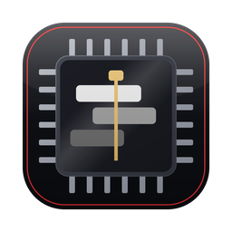
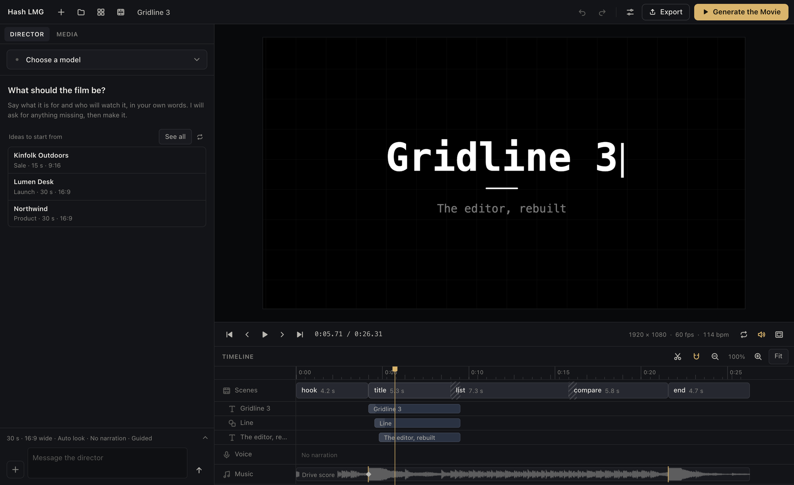
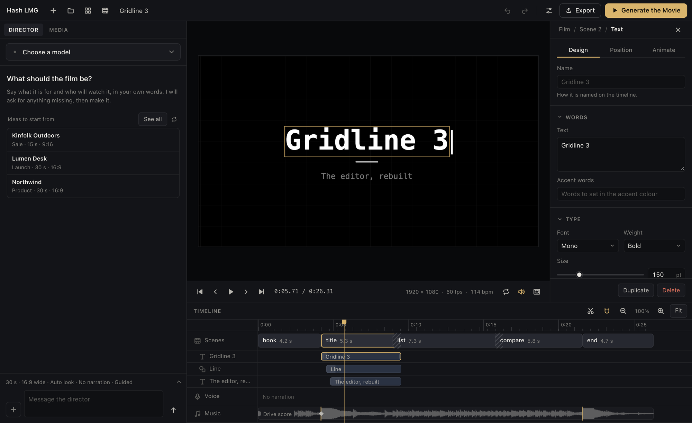
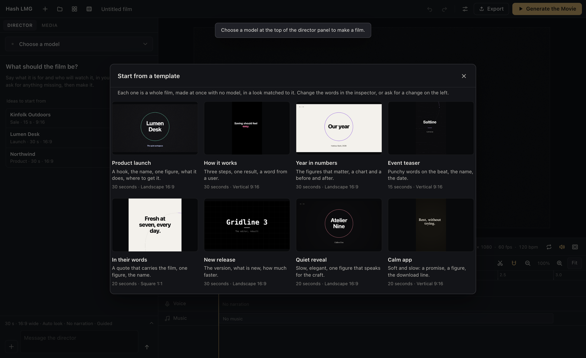
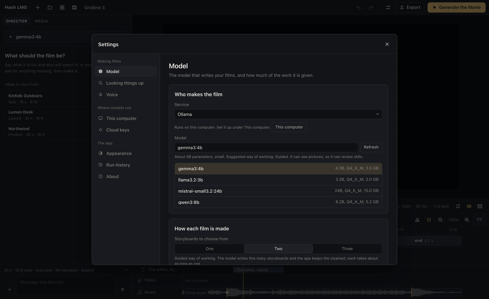
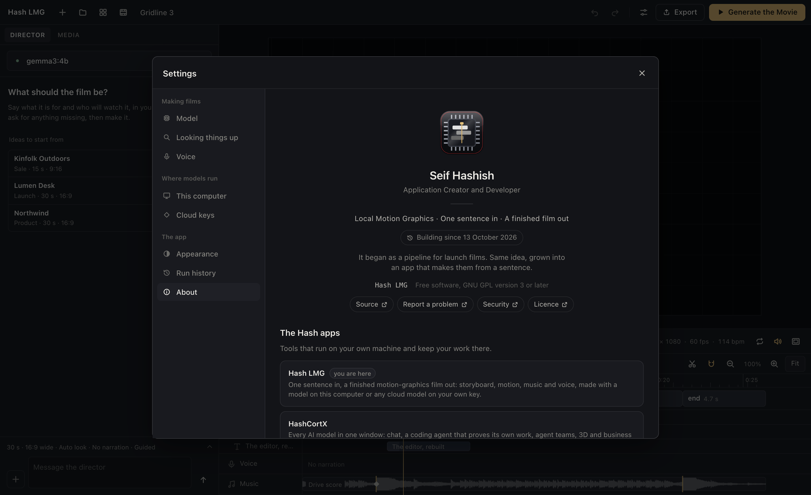

<div align="center">



# Hash LMG

### One sentence in. A finished motion-graphics film out.

Storyboard, kinetic type, drawings, an original score, narration and the export,<br>
made by a model on your laptop or any cloud model on your own key. No account, no server of ours.

**In the making since 13 October 2026.**

<a href="https://github.com/Hash-7777/open-Hash-LMG/releases/latest"></a>
<a href="https://github.com/Hash-7777/open-Hash-LMG"></a>
<a href="https://github.com/Hash-7777/open-Hash-LMG/blob/main/CHANGELOG.md"></a>
<a href="https://github.com/Hash-7777/open-Hash-LMG/issues"></a>

<a href="https://github.com/Hash-7777/open-Hash-LMG/actions/workflows/ci.yml"></a>


</div>

<br>



<br>

| | |
|---|---|
| **Small models make real films** | A small model cannot lay out a film, but it can write a good storyboard, so that is all it is asked for. Layout, timing, motion and sound are done by the app. Films have been made with a three-billion-parameter model on a laptop. |
| **No two films look alike** | The look, the accent colour, the tempo and key of the music, the transitions and every composition are directed from the brief. Make the same brief again and it comes out as a new film. |
| **It checks its own work** | Frames are rendered and measured: words off the frame, too small, too faint, too fast to read, words crossing words mid-move. What rules can fix, they fix, and the film is held to what the brief asked to see. |
| **It looks things up, with your yes** | Ask the director to look something up, or let it ask: it searches the whole web with no key and reads the pages it finds, and you see every search and every page first. |
| **Nothing leaves without you** | No account and no server of ours. With a local model every part of a film is made on your computer; a cloud model is asked only when you choose one, on your own key. |

> **Version 1.0.0, the first release.** For macOS on Apple Silicon. [Download it](https://github.com/Hash-7777/open-Hash-LMG/releases/tag/v1.0.0), or run it from source on any system.

> Type *"a 30-second launch film for my desk lamp, calm, with a voice"*. Hash LMG writes the storyboard, draws the lamp, lays out every frame, composes music for that one film, speaks the lines, checks its own stills, and has it ready to export.

## See it work

<table>
<tr>
<td width="50%" valign="top">

<br>
<b>Hand edits, when you want them.</b> Select a scene or a layer and the inspector opens: design, position and animate, keyframes at the playhead. Close it and the preview takes the room.
</td>
<td width="50%" valign="top">

<br>
<b>Eight films to start from.</b> Each template is a whole film, made at once with no model, in a look matched to it.
</td>
</tr>
<tr>
<td width="50%" valign="top">

<br>
<b>Any model.</b> Ollama, LM Studio and llama.cpp on your computer, or twelve cloud services on your own key. The app suggests how much of the work to give the model you chose.
</td>
<td width="50%" valign="top">

<br>
<b>Built in the open.</b> Free software under the GNU GPL, readable to the last line: plain JavaScript and Rust, no bundler, no minified code.
</td>
</tr>
</table>

## How a film is made

| | Step | What happens |
|---|---|---|
| **01** | **Brief** | You tell the director what the film is for, in your own words. It decides what it can, asks at most two questions, looks things up if it needs to, and waits for anything you say you will send. |
| **02** | **Storyboard** | The model writes the words and numbers, beat by beat, and draws the few things the film is about as line drawings that draw themselves on. |
| **03** | **Design** | The app directs the film from the brief, lays out every scene, times each line to how long it takes to read, and starts every scene on the beat. |
| **04** | **Check** | Key moments are rendered and measured, repaired by rule, and held to what the brief asked to see. The rest goes back to the model, once. |
| **05** | **Film** | Music composed for this film, narration laid over it as one script, mastered to platform loudness and written to MP4, MOV, WebM or GIF, 480p to 4K. |

## One app, any model

| Way of working | For | The model writes | The app does |
|---|---|---|---|
| **Guided** | Small local models, under 10B | The storyboard's words and numbers, and simple drawings | All of the layout, timing, motion and sound |
| **Plan** | Mid-size and large models | A full scene plan, a few scenes at a time | Repairs it, checks it, sends back only what is wrong |
| **Code** | The strongest cloud models | Their own animation code, frame by frame | Runs it in a locked box with no network, no storage and no clock |

The app suggests the way of working from the model's size; you can always choose another. A model that can see also reviews a contact sheet of stills, like a creative director, and asks for changes once. A run's Markdown record lists each request to the model and the tokens it used.

## Seven looks, built in

**Studio** is near-black and quiet. **Paper** is a Swiss grid with a red mark. **Mono** types on and cuts on the beat. **Vivid** changes colour field scene by scene. **Editorial** sets serif headlines and holds long. **Stage** lifts type softly onto a black stage, with figures that roll in. **Tech** draws contour lines behind precise type. By default the look is matched to the brief.

## What a film is made of

| Part | What it does |
|---|---|
| **Kinetic type** | Letters, words, typewriter, mask reveals and wipes; accent words, underlines drawn on, highlighter sweeps |
| **Motion** | Sixteen entrances, plus exits, holds and keyframes, eased the way motion designers ease: fast in, no bounce |
| **Camera and cuts** | Slow pushes and pans; push, slide, zoom-through, wipe, fade and dip; a carry that moves one element into the next scene |
| **Shapes and data** | Rings, lines, arrows and paths drawn on stroke by stroke; counters that count up; bar and line charts that grow |
| **Your media** | Your pictures, clips and songs, linked where they are and never copied, put on the beats they suit |
| **Your brand** | Text files read as your names, facts and voice; hex colours in them become the film's colour; a picture named like a logo goes where the brand shows |
| **Sound** | Music the model composes for each film as code, played by the app's own instruments, or one of seven built-in scores in the film's own tempo and key |
| **Narration** | One script laid over the film in the voice you choose, the music lowered under it; captions that light up word by word when the brief asks for them |
| **Formats** | 16:9, 9:16, 1:1 and 4:5, at 24 to 60 frames a second |

## Your hands on the playhead

| | |
|---|---|
| **Scroll or swipe over the preview** | Moves the playhead like a jog wheel: a frame a mouse-wheel notch, ten with Shift |
| **Mouse back and forward buttons, Up and Down** | The scene before or after |
| **Left and Right** | A frame back or forward, ten with Shift |
| **J, K, L** | A second back, pause, play |
| **Space, Home, End** | Play or pause, the start, the end |
| **S** | Split the scene at the playhead |
| **Pinch on the timeline** | Zoom the timeline |

## Models and voices

**On your computer:** Ollama, LM Studio and llama.cpp, asked by the desktop app, so no server switch is needed.<br>
**In the cloud, on your own key:** Anthropic, OpenAI, Google Gemini, OpenRouter, Groq, DeepSeek, Mistral, xAI, Moonshot, Together AI, Fireworks AI and Cerebras.<br>
**Looking things up:** your Tavily key if you add one, or else DuckDuckGo's results from the whole web, and Wikipedia when that finds nothing; the top pages found are read too, when you allow it.<br>
**Voices:** Chatterbox and Kokoro through your own install, any local speech server, or OpenAI's voices.

The voices are not part of the app: it runs the ones you install. Kokoro's code is MIT and its model Apache 2.0, with a GPL v3 pronunciation library; Chatterbox is MIT and marks what it speaks with an inaudible watermark; OpenAI's usage policies ask that listeners are told a voice is AI-generated.

## Install

Download `Hash-LMG_1.0.0_aarch64.dmg` from the [release](https://github.com/Hash-7777/open-Hash-LMG/releases/tag/v1.0.0), open it and drag Hash LMG into Applications. It is for Macs with Apple Silicon, on macOS 11 or later.

The app is not signed by Apple yet, so the first time macOS says it cannot check it. Open it once this way: in Applications, Control-click Hash LMG and choose **Open**, then **Open** again. If macOS still refuses, open **System Settings**, **Privacy & Security**, and choose **Open Anyway** beside Hash LMG. Or, in Terminal:

```bash
xattr -dr com.apple.quarantine "/Applications/Hash LMG.app"
```

## Run it from source

```bash
git clone https://github.com/Hash-7777/open-Hash-LMG.git
cd open-Hash-LMG
npm install
npm run tauri dev
```

You need [Node.js](https://nodejs.org) 20 or later and [Rust](https://rustup.rs) 1.87 or later, plus:

- **macOS:** the Xcode Command Line Tools (`xcode-select --install`).
- **Linux:** the web view's libraries, for example on Debian or Ubuntu: `sudo apt install build-essential pkg-config libwebkit2gtk-4.1-dev libayatana-appindicator3-dev librsvg2-dev libxdo-dev libssl-dev`.
- **Windows:** the C++ build tools for Visual Studio and the WebView2 runtime (part of Windows 11).

For a model on your computer, install [Ollama](https://ollama.com) and pull any model; Settings walks you through the rest. For a cloud model, add your key in Settings, under Cloud keys. `npm run tauri build` makes an installer under `src-tauri/target/release/bundle/`, and `npm run check` runs every check with Node alone.

## Where it stands

| Works today | Written, not yet run | Next |
|---|---|---|
| Films made from start to finish in the macOS app, with a local model through Ollama and with a cloud model (DeepSeek) | Requests to the other cloud services | Windows and Linux runs |
| The director, end to end, with a scripted model in the checks | Looking things up from the conversation, and the keyless web search, in the app | A signed release |
| The storyboard compiler in every look, film checks and automatic fixes | Voices through a Chatterbox install | |
| The editor: preview, timeline, inspector, the director's conversation, settings, the jog and keys | Motion blur; processor or graphics-chip choice for Ollama | |
| Score and mastering; narration through a Kokoro install or a local speech server, with word-timed captions | WebM export from the app (its encoders and its file were checked outside it) | |
| MP4, MOV, GIF and MP3 export by the app's own encoders, in the macOS app | | |

"Works today" means run: in the macOS app with real models, in Node with a stand-in canvas and a scripted model, and for the editor in a headless browser. The app builds from source on every system and is compiled on Linux on every push; it has been run on macOS only.

## Built to stay yours

- **No account, no server of ours.** Requests go from your computer to the model you chose, and nowhere else.
- **Works offline.** With a local model, every part of a film is made on your computer.
- **Your films are files.** A project is one JSON file; an export is a normal video.
- **Walled in.** Code a model writes runs with no network, storage or clock; every question to a model treats your files and the web as material, never instructions. See [docs/SECURITY.md](docs/SECURITY.md).

## Under the hood

```
src/
  index.html       the editor window
  css/             the editor's colours, type and layout, dark and light
  core/            pure modules, no page access: the checks run them in Node
    scene/         format, normaliser, film checks, storyboard, direction, layouts, compiler, examples
    engine/        easing, keyframes, paths, the drawing kit, motion, caption phrases, the renderer
    director/      the conversation, prompts and the rule every one ends with, the plan-check-revise
                   loop, drawings, music, the brief check, the code check, the run record
    research/      what to look up, pages read as text, the notes
    providers/     model services, requests and streams, model sizes, voices
    audio/         synth, score, grooves, the music kit and its player, narration mix, loudness, word timing, WAV
    export/        the MP4, MOV, WebM and ZIP writers
  render/          the locked-down render worker, its host, footage frames, video export
  platform/        the desktop app or a browser: projects, files, settings and keys
  app/             the editor window: its state, panels, dialogs and the jog
src-tauri/         the desktop side: films, exports, sound, encoders, media, voices, keys, the relay, web search and reading, the window's walls
scripts/checks/    the check suite: every script under it runs on npm run check
```

How the parts fit together: [docs/ARCHITECTURE.md](docs/ARCHITECTURE.md). The walls around keys, files, the network and code a model writes: [docs/SECURITY.md](docs/SECURITY.md). The motion rules the films follow: [docs/MOTION-RULES.md](docs/MOTION-RULES.md). What has changed: [CHANGELOG.md](CHANGELOG.md).

## Contributing

Issues and pull requests are welcome. Before a pull request, run `npm run check`, and `cargo test` in `src-tauri/` when the Rust side changed; [CONTRIBUTING.md](CONTRIBUTING.md) has the few rules the code keeps.

## Licence

GNU General Public License, version 3 or later. See [LICENSE](LICENSE).
